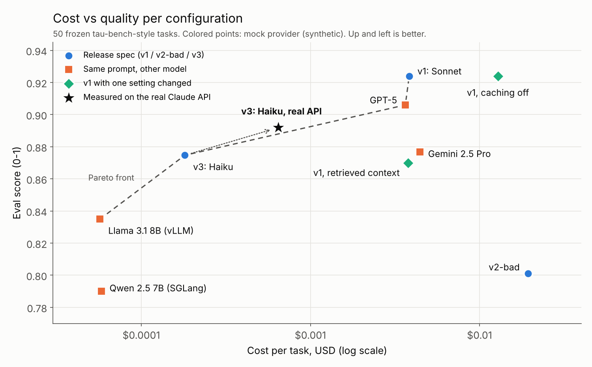

# Agent Deployment Control Plane

> **Ship changes to an AI agent the way you ship code: test every change, release it to a slice of traffic, and roll it back automatically when it gets worse.**

[](#) [](#) [](#) [](#) [](#) [](LICENSE)

## Summary

An AI agent is a prompt, a model and a set of tools. A one-line change to any of them can make it worse, and nothing errors when that happens. This project treats the three as one versioned release (`AgentSpec`) and puts it through the same safety net as code:

1. **Eval gate in CI**: every version runs 50 airline and retail support tasks and is graded on what it actually did (was the booking cancelled?), not on how the reply sounds.
2. **Canary rollout**: a new version gets 10% of traffic, then 25%, 50% and 100%.
3. **Automatic rollback**: a controller compares the new version to the current one on **cost per task, p95 latency and eval score**. Worse on all three: rolled back. Better: promoted. A trade-off (cheaper but slightly worse): paused, and a GitHub issue is opened for a human to decide.

## How it works

```
change to prompt / model / tools
  → AgentSpec version registered in MLflow (candidate)
  → eval gate in GitHub Actions (Inspect AI + promptfoo, 50 frozen tasks)
  → Argo CD syncs, Argo Rollouts shifts 10% of traffic through Istio
  → runtime emits OpenTelemetry → Prometheus, Grafana, Tempo, Loki, Langfuse
  → rollback controller reads canary vs stable
  → promote | roll back (Argo abort, registry stage rolled_back) | needs-human GitHub issue
```

- **Agent runtime**: FastAPI service; the agent loop is a LangGraph state graph; tools are served over MCP; outputs are Pydantic models. One provider interface covers Anthropic (prompt caching on), OpenAI, Gemini, AWS Bedrock, Azure OpenAI / AI Foundry, vLLM and SGLang, plus a mock that replays recorded answers so the whole pipeline runs without API keys.
- **Rollback controller**: Pareto rule with a noise band, plus hard SLO guards (error rate, latency, tool failures). Acts on the Argo Rollouts API and the MLflow registry.
- **Feature flags**: OpenFeature + flagd turn new tools on only for the canary.
- **SLOs**: declared once in `infra/slo/slo.yaml`, generated into Prometheus burn-rate alerts with error budgets.
- **Chaos**: LitmusChaos experiments on canary pods, plus an in-process injector (degraded prompt, added latency, broken tool) to measure time to detect and time to roll back.
- **Cloud**: Terraform for EKS (IRSA, ECR, Bedrock IAM, S3) and AKS (Entra workload identity, ACR, Azure OpenAI, AI Foundry, Blob).

Architecture diagram: [docs/ARCHITECTURE.md](docs/ARCHITECTURE.md).

## Results



**Real Claude API run** (Claude Haiku 5.5, all 50 tasks): eval score 0.892, 80% of tasks fully correct, $0.00064 per task, p95 latency 6.8 s, 81% of input tokens served from prompt cache.

| Rollout experiment | Result |
|---|---|
| Time to detect a bad version, first canary step 10% / 25% | 97 s / 48 s |
| Wrong rollbacks over 13 candidate versions: Pareto rule / per-metric thresholds / fixed thresholds | 0 / 1 / 11 |
| Time to detect injected faults: degraded prompt / +1.5 s latency / broken tool | 134 s / 97 s / 44–70 s |
| Prompt caching off vs on (same quality) | 3.3× the cost |

Colored points and the rollout experiments use the mock provider (recorded answers, simulated time). Full table: [results/results.md](results/results.md).

## Quick start

Requires Python 3.12+, [uv](https://docs.astral.sh/uv/) and `make`. No API keys needed.

```bash
git clone https://github.com/jahnavi-yelamanchi/agent-deploy-control-plane.git
cd agent-deploy-control-plane
make install
```

Run the whole loop in-process (about 20 s): v1 goes to production, a bad v2 is caught at 10% canary and rolled back, a cheaper-but-worse v3 is paused for human review.

```bash
make demo-local
```

```text
Decisions
  rollout      decision     verdicts (cost/p95/score)     TTD    TTR
  v2-bad       rollback     worse/worse/equal            105s   110s
  v3-tradeoff  needs_human  better/better/worse          450s      -
Registry: v1=production, v2=rolled_back, v3=canary
```

Tests and the eval gate:

```bash
make test
make eval-gate
```

With a real model: put `ANTHROPIC_API_KEY` in `.env` (`cp .env.example .env`), then

```bash
make bootstrap
set -a; source .env; set +a
uv run python -m adcp.evals.runner --spec specs/v3-tradeoff.yaml --context full --limit 5 --out runs/try.jsonl --experiment try
```

On Docker and Kubernetes (kind): `make up-lite` (services only) or `make up` then `make demo` (cluster, canary, rollback). Infrastructure checks without a cloud account: `make plan-aws`, `make plan-azure`, `make validate-k8s`.

## Tech stack

| Area | Tools |
|---|---|
| Agent | Python, FastAPI, LangGraph, MCP, Pydantic, Anthropic / OpenAI / Gemini / Bedrock / Azure SDKs |
| Open models | vLLM on Ray Serve and KServe, SGLang; prefix caching, KV cache settings |
| Evals | Inspect AI, promptfoo, tau-bench-style tasks with state-based grading |
| Data | MLflow Model Registry (Postgres, MinIO), Postgres, Redis, Kafka API (Redpanda) |
| Delivery | GitHub Actions, Argo CD (GitOps), Argo Rollouts (canary, blue-green), Istio, Helm, Kustomize |
| Observability | OpenTelemetry (GenAI semantic conventions), OTel Collector, Prometheus, Grafana, Tempo, Loki, Langfuse |
| Reliability | SLOs and burn-rate alerts, LitmusChaos, OpenFeature + flagd |
| Cloud and cost | Terraform (EKS, AKS), Infracost, token cost model |

## Design choices

- **One versioned artifact, not three**: rolling back only the prompt can leave it running on a model it was never tested with. [ADR-001](docs/ADR-001-agentspec-artifact.md)
- **Pareto rule over thresholds**: fixed limits wrongly rolled back 11 of 12 good versions; comparing all three metrics at once rolled back none. [ADR-006](docs/ADR-006-pareto-rollback.md)
- **Grade the end state, not the text**: a reply can say "cancelled" when nothing was cancelled. [ADR-015](docs/ADR-015-eval-layers.md)
- **Mock provider from recorded answers**: the full pipeline runs in CI for free and gives the same score for the same behavior. [ADR-003](docs/ADR-003-mock-provider-fixtures.md)
- **Argo Rollouts + Istio**: exact traffic percentages and an abort API the controller can call. [ADR-007](docs/ADR-007-argo-rollouts-istio.md)
- **OpenTelemetry for everything**: one instrumentation path feeds Prometheus, Tempo, Loki and Langfuse. [ADR-009](docs/ADR-009-otel-genai.md)

All 21 decision records: [docs/](docs/).

## Repository structure

```
.
├─ src/adcp/
│  ├─ spec.py            # AgentSpec: prompt + model + tools + params, versioned
│  ├─ runtime/           # FastAPI app, LangGraph agent, MCP tools, flags, telemetry
│  ├─ providers/         # Anthropic, OpenAI, Gemini, Bedrock, Azure, vLLM, SGLang, mock
│  ├─ env/               # airline and retail environment, 50 tasks, grading
│  ├─ evals/             # runner, Inspect AI suite, gate, comparison matrix
│  ├─ rollback/          # Pareto rule, controller, Argo and GitHub clients
│  ├─ rollout/           # canary and blue-green simulator, experiments
│  ├─ chaos/             # fault injector
│  ├─ finops/            # token cost model, EKS vs AKS cost report
│  └─ registry.py        # MLflow Model Registry client
├─ specs/                # v1 (good), v2-bad, v3-tradeoff, per-model specs
├─ evals/                # frozen task set, Inspect AI and promptfoo configs
├─ infra/
│  ├─ deploy/            # Helm charts, Argo CD apps, Kustomize overlays, Istio, KServe, Ray, kind
│  ├─ compose/           # local data plane and observability stack
│  ├─ observability/     # OTel Collector, Prometheus rules, Grafana dashboards
│  ├─ slo/               # SLO spec
│  ├─ chaos/             # LitmusChaos experiments
│  └─ terraform/         # aws (EKS) and azure (AKS)
├─ .github/workflows/    # ci, eval-gate, release, nightly-eval, e2e
└─ tests/                # smoke tests per package + end-to-end loop
```

## License

MIT
