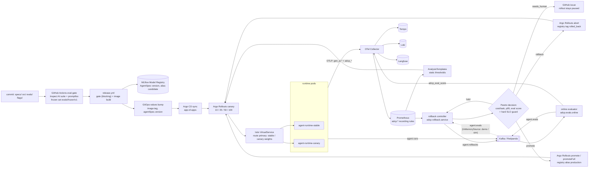
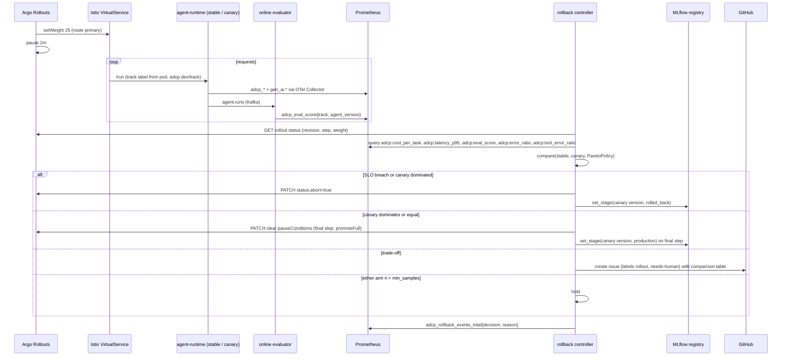

# Architecture

## Rollout and rollback loop

## One canary analysis step

## Decision rule (`src/adcp/rollback/pareto.py`)

| Order | Condition | Decision |
|---|---|---|
| 1 | Canary n >= 10 and error ratio > 0.05, p95 > 15000 ms, or tool error rate > stable + 0.15 | rollback (`slo_breach`) |
| 2 | Either arm n < 20 | hold |
| 3 | No objective better, at least one worse | rollback (`dominated`) |
| 4 | No objective worse | promote (`dominates` / `equal`) |
| 5 | At least one better and one worse | needs_human (`tradeoff`) |

Per-objective `equal` band: max(tolerance, 3 x combined standard error). Tolerances: cost 3% rel, p95 5% rel, eval score 0.02 abs. Prometheus source has no standard errors, so it uses the fixed tolerances. `naive` rule (baseline): rollback if any objective is worse beyond its tolerance.

## Components

| Module / path | Responsibility |
|---|---|
| `src/adcp/spec.py` | `AgentSpec`, `Stage`, `Provider`, fingerprint, YAML IO |
| `src/adcp/types.py` | `RunResult`, `EvalResult`, `ArmMetrics`, `Usage` |
| `src/adcp/registry.py` | `SpecRegistry` on MLflow: register, aliases, `rolled_back` tag, history |
| `src/adcp/cli.py` | `adcp run / register / promote / history / serve / mcp` |
| `src/adcp/providers/` | Adapters (Anthropic, OpenAI, Gemini, Bedrock, Azure, vLLM, SGLang), mock fixture replay, `get_provider` |
| `src/adcp/runtime/agent.py` | LangGraph loop, context strategy, cost/latency accounting, budget |
| `src/adcp/runtime/app.py` | FastAPI `/run /healthz /readyz /spec`; spec from file or registry alias; track resolution |
| `src/adcp/runtime/harness.py` | `run_task` / `arun_task`; fault hooks |
| `src/adcp/runtime/mcp_server.py`, `mcp_client.py` | MCP server `tau`; in-process / stdio / HTTP client |
| `src/adcp/runtime/flags.py` | OpenFeature + flagd (RPC, in-process, in-memory fallback) |
| `src/adcp/runtime/budget.py`, `store.py` | Redis / local budgets and rate limits; Postgres / SQLite run store |
| `src/adcp/runtime/events.py` | Kafka (aiokafka) or in-process bus; topics |
| `src/adcp/runtime/telemetry.py` | OTel traces + metrics, GenAI semconv, `adcp_*` |
| `src/adcp/runtime/deep_agent.py` | Optional LangChain Deep Agents builder (reference) |
| `src/adcp/env/` | tau-bench-style airline/retail env, tasks, state-based scoring |
| `src/adcp/evals/runner.py`, `gate.py`, `freeze.py` | Offline eval, CI gate vs `evals/gate.yaml`, frozen-set hash |
| `src/adcp/evals/inspect_suite.py`, `inspect_runner.py`; `evals/inspect/`, `evals/promptfoo/` | Inspect AI suite; promptfoo config + Python provider |
| `src/adcp/evals/matrix.py`, `metrics.py` | Comparison matrix; `runs/*.jsonl` row schema |
| `src/adcp/evals/online.py` | `agent.runs` -> score -> `agent.evals` + `adcp_eval_score` |
| `src/adcp/rollback/pareto.py` | Pareto / naive rules, SLO guard |
| `src/adcp/rollback/controller.py` | Decide -> act (Argo, registry, GitHub), dedupe per revision/step, publish `agent.rollbacks` |
| `src/adcp/rollback/metrics_source.py` | `PrometheusSource` (recording rules), `InMemorySource` (runs/evals, standard errors) |
| `src/adcp/rollback/argo.py`, `github.py`, `service.py` | Rollout status patches; issue client (dry run writes `runs/issues/*.md`); FastAPI :8090 |
| `src/adcp/rollout/sim.py`, `experiments.py` | Simulated canary / blue-green over the real harness; canary weight + rule experiments |
| `src/adcp/chaos/faults.py`, `scripts/chaos_suite.py`, `chaos/litmus/` | Degrade prompt, add latency, kill tool; MTTD/MTTR; Litmus pod-delete, network latency |
| `src/adcp/demo.py` | `make demo-local`: v1 -> production, v2-bad -> rollback, v3 -> needs_human |
| `src/adcp/finops/` | Token cost, price tables, AKS vs EKS report |
| `deploy/helm/agent-runtime/` | Rollout (canary / blueGreen), AnalysisTemplates, VirtualService, DestinationRule, services, HPA |
| `deploy/helm/rollback-controller/` | Controller + online evaluator deployments, RBAC for rollouts patch |
| `deploy/argocd/`, `deploy/kustomize/` | App-of-apps; local / aws / azure overlays |
| `deploy/istio/`, `deploy/serving/` | Gateway, mTLS, telemetry; Ray Serve vLLM, KServe, SGLang |
| `observability/`, `slo/`, `scripts/gen_slo_rules.py` | Collector, Prometheus rules, Grafana dashboards, Tempo, Loki; SLO -> burn-rate rules |
| `terraform/aws/`, `terraform/azure/` | EKS + IRSA + ECR + S3; AKS + workload identity + ACR + Azure OpenAI + AI Foundry |
| `compose/`, `deploy/kind/`, `scripts/up.sh`, `scripts/demo.sh` | Local data plane + observability; kind cluster; cluster demo |
| `.github/workflows/` | `ci`, `eval-gate`, `release`, `nightly-eval` |
